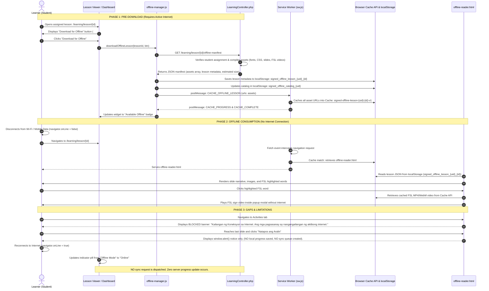

# SignED — Offline Learning Implementation Audit

**Document Version:** 1.0.0  
**Audit Date:** October 10, 2026  
**Auditor:** DeepMind Antigravity AI  
**Scope:** Complete inspection and verification of offline caching, Service Worker, offline lesson reader, connectivity listeners, local storage, and server synchronization capabilities.

---

## 1. Executive Summary & Current Status

The current offline implementation in SignED is an **Offline Read-Only Lesson Caching MVP**. 

It allows an authenticated learner with an active internet connection to pre-download an assigned lesson pack (consisting of the lesson narrative slides, embedded illustrations, self-hosted fonts, and Filipino Sign Language [FSL] demonstration videos and GIFs). Once cached in the browser's Cache API and localStorage, the learner can disconnect from the internet and read the entire lesson, navigate between slides, and play FSL sign videos locally via a standalone offline reader.

However, **it is NOT a full offline learning and synchronization system**:
- **Formative activities, quizzes, and tests DO NOT work offline** (explicitly blocked in the offline interface).
- **Learner progress is NOT saved offline** (reading through slides offline does not record progress to localStorage or queue completion).
- **There is NO background sync, NO pending synchronization queue, and NO server sync reconciliation endpoint.**

---

## 2. Actual Current Offline User Flow

The following sequence reflects the **exact, verified user flow supported by the source code**:

---

## 3. What Can Currently Work Offline (Audit Matrix)

| Feature / Element | Status | Code Evidence | Technical Assessment |
|---|---|---|---|
| **Lesson Text / Slides** | **WORKING** | [`public/offline-reader.html:466-503`](file:///c:/laragon/www/Signedd/public/offline-reader.html#L466-L503) | Stored as JSON in `localStorage` under `signed_offline_lesson_{learnerId}_{lessonId}`. Rendered with slide titles, slide numbers, content blocks, and guide question callouts. |
| **Images** | **WORKING** | [`public/sw.js:144-177`](file:///c:/laragon/www/Signedd/public/sw.js#L144-L177), [`LearningController.php:320-336`](file:///c:/laragon/www/Signedd/app/Controllers/LearningController.php#L320-L336) | All image tags (``) in lesson slides are parsed by `offlineLessonManifest()`, added to the asset list, cached in Cache API, and served via Service Worker. |
| **FSL Videos / GIFs** | **WORKING** | [`public/sw.js:34-40`](file:///c:/laragon/www/Signedd/public/sw.js#L34-L40), [`LearningController.php:369-450`](file:///c:/laragon/www/Signedd/app/Controllers/LearningController.php#L369-L450) | Referenced FSL video paths (`.mp4`, `.webm`, `.mov`, `.gif`) from both explicit `[fsl:word]` tags and dictionary matches are pre-cached and played via [`public/js/fsl-modal.js`](file:///c:/laragon/www/Signedd/public/js/fsl-modal.js). |
| **Activities / Quizzes** | **NOT IMPLEMENTED** | [`public/offline-reader.html:279-299`](file:///c:/laragon/www/Signedd/public/offline-reader.html#L279-L299) | Explicitly blocked in the offline reader interface. Tab 2 displays a permanent warning banner explaining that internet connectivity is required. |
| **Quiz Answers / Submissions** | **NOT IMPLEMENTED** | [`app/Controllers/LearningController.php:578-605`](file:///c:/laragon/www/Signedd/app/Controllers/LearningController.php#L578-L605) | Submissions require an active HTTP `POST /learning/activity/{id}/submit` connection; no local evaluation or offline submission buffer exists. |
| **Local Progress Recording** | **NOT IMPLEMENTED** | [`public/offline-reader.html:509-515`](file:///c:/laragon/www/Signedd/public/offline-reader.html#L509-L515) | Reaching the final slide merely triggers `alert('Magaling! Natapos mo ang lahat ng pahina ng araling ito nang offline.');`. No completion flag, timestamp, or progress percentage is written to `localStorage`. |
| **XP / Stars / Badges** | **NOT IMPLEMENTED** | [`app/Controllers/LearningController.php:524`](file:///c:/laragon/www/Signedd/app/Controllers/LearningController.php#L524), [`app/Models/GamificationModel.php`](file:///c:/laragon/www/Signedd/app/Models/GamificationModel.php) | XP and stars are exclusively computed and committed server-side via MySQL tables (`activity_stars`, `activity_attempts`, `user_points`). No offline ledger exists. |
| **Authentication / Session** | **NOT IMPLEMENTED** | [`app/Middleware/SessionMiddleware.php`](file:///c:/laragon/www/Signedd/app/Middleware/SessionMiddleware.php) | SignED relies on standard PHP server session cookies (`PHPSESSID`). A learner cannot log in, re-authenticate, or switch users while offline. |
| **Resource Hub Resources** | **NOT IMPLEMENTED** | [`app/Controllers/IEPImplementationController.php:2112`](file:///c:/laragon/www/Signedd/app/Controllers/IEPImplementationController.php#L2112) | Resource Hub browsing, previewing, and cloning require direct live database queries. Resources cannot be cached for offline hub browsing. |

---

## 4. Synchronization Mechanism Evaluation

| Sync Capability | Current Status | Detailed Code Finding |
|---|---|---|
| **Local Progress Storage** | **NOT IMPLEMENTED** | There is no storage structure (in `localStorage` or `IndexedDB`) dedicated to holding offline reading logs or quiz answers. |
| **Pending Sync Queue** | **NOT IMPLEMENTED** | No FIFO queue or array exists (e.g., `pending_sync_queue = []`). |
| **Unique Attempt IDs (UUIDs)** | **NOT IMPLEMENTED** | Submissions rely strictly on database `AUTO_INCREMENT` IDs upon live HTTP POST. No client-generated UUIDs (RFC 4122) exist. |
| **Conflict Handling** | **NOT IMPLEMENTED** | No timestamp reconciliation, Last-Write-Wins (LWW) policy, or version vector logic exists. |
| **Duplicate Prevention** | **NOT IMPLEMENTED** | No idempotency keys or request deduplication logic exists for learner activity submissions. |
| **Reconnect Detection** | **PARTIALLY WORKING** | Connectivity events (`window.addEventListener('online')` and `'offline'`) exist in [`offline-manager.js:50-51`](file:///c:/laragon/www/Signedd/public/js/offline-manager.js#L50-L51), but they **only toggle the visual UI badge** between "Online" and "Offline Mode". They dispatch no network sync requests. |
| **Server Sync Endpoint** | **NOT IMPLEMENTED** | There is no batch or queue reconciliation API route (e.g., `/api/learning/sync` does not exist in `routes/web.php`). |

---

## 5. Offline Source Files Inventory

| Component Type | Exact File Path | Key Functions & Responsibilities |
|---|---|---|
| **Service Worker** | [`public/sw.js`](file:///c:/laragon/www/Signedd/public/sw.js) | Registers lifecycle listeners; handles `CACHE_OFFLINE_LESSON` and `DELETE_OFFLINE_LESSON` messages; intercepts navigation requests to `/learning/lesson/{id}` and serves cached `offline-reader.html`; serves cached static assets (fonts, styles, icons, images, FSL videos). |
| **Client Manager** | [`public/js/offline-manager.js`](file:///c:/laragon/www/Signedd/public/js/offline-manager.js) | Registers `sw.js`; monitors online/offline status; manages `downloadOfflineLesson()` and `removeOfflineLesson()`; stores lesson metadata in `localStorage`; updates UI widgets on lesson pages and learner dashboard. |
| **Offline Reader** | [`public/offline-reader.html`](file:///c:/laragon/www/Signedd/public/offline-reader.html) | Standalone, self-hosted HTML5 reader; loads lesson data from `localStorage`; renders slides; highlights FSL vocabulary; triggers modal sign video player; disables activities tab with notice. |
| **Controller** | [`app/Controllers/LearningController.php`](file:///c:/laragon/www/Signedd/app/Controllers/LearningController.php) | Method `offlineLessonManifest()` (lines 247–494): gathers core shell assets, parses slide images and FSL video paths, matches dictionary keywords, calculates byte size, and emits JSON manifest. |
| **Lesson View** | [`app/Views/learning/lesson_view.php`](file:///c:/laragon/www/Signedd/app/Views/learning/lesson_view.php) | Contains `#offlineLessonWidget` container (line 98), network pill indicator (line 94), and online/offline event listener for External Mastery activities (line 1248). |
| **Learner Dashboard** | [`app/Views/dashboard/learner.php`](file:///c:/laragon/www/Signedd/app/Views/dashboard/learner.php) | Contains `.offline-badge-slot` elements on assigned lesson cards (line 153), dynamically injected with "Available Offline" badges. |
| **App Layout Header** | [`app/Views/layouts/header.php`](file:///c:/laragon/www/Signedd/app/Views/layouts/header.php) | Enqueues [`public/js/offline-manager.js`](file:///c:/laragon/www/Signedd/public/js/offline-manager.js) (lines 38–40) for all logged-in sessions. |
| **Modal Video Player** | [`public/js/fsl-modal.js`](file:///c:/laragon/www/Signedd/public/js/fsl-modal.js) | Standalone interactive modal used for playing FSL sign demonstration videos and GIFs both online and offline. |
| **Route Definition** | [`routes/web.php`](file:///c:/laragon/www/Signedd/routes/web.php) | Line 233 registers `GET /learning/lesson/{id}/offline-manifest`. |

---

## 6. Storage Mechanisms & Database Utilization

### Browser Local Storage:
1. **Cache Storage API (Service Worker):**
   - **Cache Name Pattern:** `signed-offline-lesson-${learnerId}-${lessonId}-v1`
   - **Static Cache Name:** `signed-static-v1`
   - **Contents:** `offline-reader.html`, CSS files (`custom.css`, `learner.css`, `poppins.css`, `phosphor/style.css`), WOFF2 fonts (`Poppins`, `Phosphor-Bold`), JavaScript files (`fsl-modal.js`, `app.js`, `offline-manager.js`), slide images (`uploads/lesson_editor/...`), FSL video files (`uploads/fsl_custom_videos/...`, `uploads/fsl_library/...`).
2. **Local Storage (`window.localStorage`):**
   - **`signed_active_learner_id`:** String representation of the authenticated user's ID.
   - **`signed_offline_lesson_${learnerId}_${lessonId}`:** JSON string containing the complete serialized lesson object (id, title, domain, school_year, total_pages, pages array, fsl_signs array, mainstream_mastery_url).
   - **`signed_offline_catalog_${learnerId}`:** JSON array containing catalog of all downloaded lessons for that student (`[{ id, title, domain, total_pages, downloaded_at }]`).
3. **IndexedDB:**
   - **Status:** **NOT USED.** Zero IndexedDB object stores exist in the current application.

### Server Database Tables Involved:
- `lesson_plans` (source of title, domain, mastery URL)
- `lesson_plan_pages` (source of slide text, media attachments, guide questions)
- `fsl_signs` (source of sign vocabulary, video paths, categories)
- `lesson_assignments` & `student_records` (used to verify learner access permissions)
- *(Note: `lesson_page_progress`, `activity_attempts`, and `lms_submissions` are server-only tables that are **not** written to or queried during offline sessions).*

---

## 7. Incomplete Areas & Gaps for True Offline Learning

For SignED to achieve true, end-to-end offline learning and later synchronization, the following foundational components must still be built:

1. **Local Progress & Completion Logging:**
   - Modify `offline-reader.html` to record page visits, completion timestamps, and reading duration into `localStorage` or `IndexedDB`.
2. **Offline Formative Activity Player:**
   - Package activity question data (multiple choice, sign-matching, true/false) inside `offlineLessonManifest()`.
   - Build a lightweight offline activity renderer inside `offline-reader.html`.
3. **Local Submission & Attempt Queue:**
   - Establish an IndexedDB or localStorage array (`signed_offline_sync_queue`) storing:
     - Client-generated UUID (`attempt_uuid`)
     - `student_id` & `lesson_plan_id` / `activity_id`
     - Answer selections & calculated score
     - Timestamp (`completed_at`)
     - Sync status (`pending`, `syncing`, `failed`)
4. **Reconnect Sync Dispatcher:**
   - In `offline-manager.js`, hook into `window.addEventListener('online', ...)` to automatically inspect the queue and flush pending attempts to the server.
5. **Server Reconciliation API Endpoint:**
   - Create a dedicated controller route (e.g., `POST /learning/sync-offline-progress`).
   - Implement idempotency checking to prevent duplicate XP/star awards if the same attempt UUID is re-sent.
   - Update `lesson_page_progress`, `activity_attempts`, and award gamification XP in a single atomic transaction.
