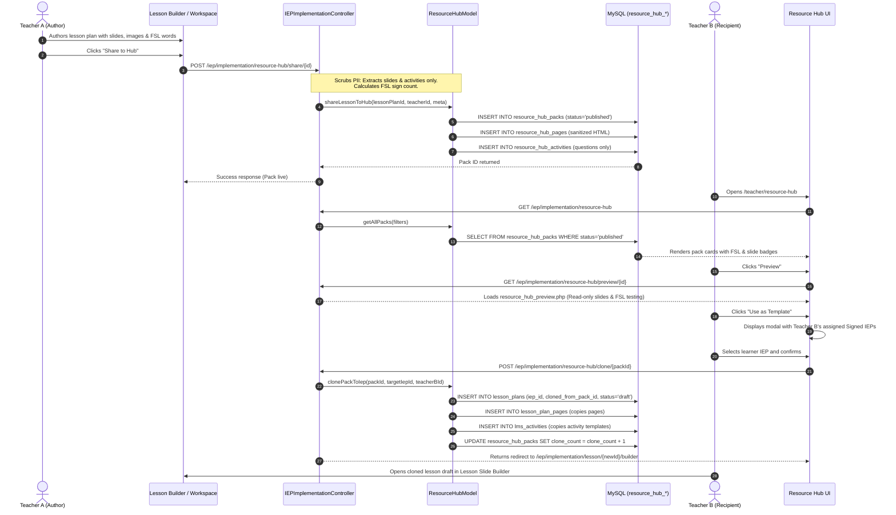

# SignED — Accessibility Pack Resource Hub Implementation Audit

**Document Version:** 1.0.0  
**Audit Date:** October 10, 2026  
**Auditor:** DeepMind Antigravity AI  
**Scope:** Complete inspection and verification of the Resource Hub codebase, database schema, routes, controllers, models, and UI views.

---

## 1. Executive Summary & Current Status

The **Resource Hub** is a functional teacher-to-teacher collaborative repository designed specifically for Deaf-accessible instructional materials in Special Education (SPED). It operates under strict learner data privacy rules: lesson slides, instructional visuals, and Filipino Sign Language (FSL) vocabulary can be shared and cloned across teachers, but **all learner Personal Identifiable Information (PII), IEP identifiers, student IDs, and assessment/grading records are completely scrubbed**.

### Current Implementation Status:
- **Implemented & Working:**
  - Resource Hub Browse & Filter Interface (`/iep/implementation/resource-hub` and `/teacher/resource-hub`).
  - Search by keyword (title, description, competency, tags) and multi-domain filtering (PDSP domains, learning levels, FSL-only toggle).
  - "My Shared Packs" management tab with pack unshare/archive capability.
  - Read-Only Interactive Slide Deck Preview (`/iep/implementation/resource-hub/preview/{id}`).
  - Live FSL interactive popup modal preview within slides.
  - Transactional Pack-to-IEP Cloning ("Use as Template" modal) that generates an independent draft lesson plan linked to a target signed IEP, copying slides and formative activity templates while incrementing the pack's adaptation counter.
  - Sharing completed lesson plans directly into the Resource Hub from both the **IEP Workspace** and the **Lesson Slide Builder**.
  - Mainstream Mastery handoff linking (optional external practice URLs attached to shared packs).
- **Incomplete / Planned / Missing:**
  - **No Approval / Moderation Queue:** Shared packs have status defaulted directly to `'published'`. There is no administrator review or moderation approval workflow before resources become visible to other teachers.
  - **No Direct File Download / Export:** Resources cannot be downloaded as standalone ZIP, PDF, or SCORM packages; they exist exclusively as database records within the application.
  - **No Marketplace / Payment / Subscription Logic:** The repository is 100% free and internal; no commerce or subscription code exists.
  - **No Learner Access:** The hub is restricted to teachers and administrators; learners cannot browse the hub.
  - **No Structured Tag/Category Taxonomy Tables:** Tags are stored as unstructured comma-separated strings (`tags` VARCHAR) and domains are restricted to the fixed `pdsp_domain` ENUM.

---

## 2. Verified Current User Flow

The following sequence reflects the **exact current codebase implementation**:



---

## 3. Routes & Endpoints

All Resource Hub routes are defined in [`routes/web.php`](file:///c:/laragon/www/Signedd/routes/web.php) and protected by the `'iep.implement'` permission check via [`RoleMiddleware.php`](file:///c:/laragon/www/Signedd/app/Middleware/RoleMiddleware.php) (accessible to `sped_teacher`, `teacher`, `master_teacher`, `admin`):

| HTTP Method | Route URL | Controller & Action | Required Role / Permission | Purpose |
|---|---|---|---|---|
| `GET` | `/iep/implementation/resource-hub` | `IEPImplementationController@resourceHub` | `iep.implement` (Teachers/Admin) | Main Resource Hub page (Browse & My Packs tabs, filters, search). |
| `GET` | `/teacher/resource-hub` | `IEPImplementationController@resourceHub` | `iep.implement` (Teachers/Admin) | Alias URL for teacher convenience. |
| `GET` | `/iep/implementation/resource-hub/preview/{id}` | `IEPImplementationController@previewResourcePack` | `iep.implement` (Teachers/Admin) | Read-only slide navigator preview with live FSL word testing. |
| `GET` | `/teacher/resource-hub/preview/{id}` | `IEPImplementationController@previewResourcePack` | `iep.implement` (Teachers/Admin) | Alias preview URL. |
| `POST` | `/iep/implementation/resource-hub/share/{id}` | `IEPImplementationController@shareToResourceHub` | `iep.implement` (Managing Teacher/Admin) | Publishes an existing completed lesson plan into the Resource Hub as a sanitized pack. |
| `POST` | `/iep/implementation/resource-hub/clone/{id}` | `IEPImplementationController@cloneFromResourceHub` | `iep.implement` (Teachers with Signed IEP) | Clones a pack into an assigned signed IEP context as an independent draft. |
| `POST` | `/iep/implementation/resource-hub/unshare/{id}` | `IEPImplementationController@unshareFromResourceHub` | `iep.implement` (Pack Author or Admin) | Sets pack status to `'archived'`, removing it from the public browse tab. |
| `POST` | `/iep/implementation/lesson-plan/{id}/mastery-result` | `IEPImplementationController@recordMasteryResult` | `iep.implement` (Teachers/Admin) | Records manual evidence/score for external mainstream mastery activity. |
| `GET` | `/iep/implementation/lesson-plan/{id}/mastery-result/{student_id}` | `IEPImplementationController@getMasteryResult` | `iep.implement` (Teachers/Admin) | Retrieves recorded mainstream mastery evidence for a student. |
| `POST` | `/iep/implementation/lesson-plan/{id}/mastery-resource` | `IEPImplementationController@updateMasteryResource` | `iep.implement` (Managing Teacher/Admin) | Updates external practice activity URL and title on a lesson plan. |

---

## 4. Source Files Inventory

| Component Type | Exact File Path | Key Functions / Responsibilities |
|---|---|---|
| **Controller** | [`app/Controllers/IEPImplementationController.php`](file:///c:/laragon/www/Signedd/app/Controllers/IEPImplementationController.php) | Lines 2106–2335: `resourceHub()`, `previewResourcePack()`, `shareToResourceHub()`, `cloneFromResourceHub()`, `unshareFromResourceHub()`. |
| **Model** | [`app/Models/ResourceHubModel.php`](file:///c:/laragon/www/Signedd/app/Models/ResourceHubModel.php) | Lines 1–388: `getAllPacks()`, `getPackById()`, `getPackPages()`, `getPackActivities()`, `countFslSignsInHtml()`, `shareLessonToHub()`, `clonePackToIep()`, `unsharePack()`, `getManageableIepsForTeacher()`. |
| **Associated Model** | [`app/Models/LessonPlanModel.php`](file:///c:/laragon/www/Signedd/app/Models/LessonPlanModel.php) | Provides lesson plan lookup (`findById`), slide querying (`getPagesByLessonPlan`), activities querying (`getActivitiesByIepId`), and signed IEP access (`getSignedIEPsForTeacher`). |
| **Associated Model** | [`app/Models/ExternalMasteryModel.php`](file:///c:/laragon/www/Signedd/app/Models/ExternalMasteryModel.php) | Manages external mainstream activity tracking table `external_mastery_results`. |
| **Security Helper** | [`app/Helpers/HtmlSanitizer.php`](file:///c:/laragon/www/Signedd/app/Helpers/HtmlSanitizer.php) | Method `cleanLessonHtml()`: Sanitizes HTML slide content using regex and DOM parsing while preserving `.fsl-word` spans, data attributes, tables, and instructional media tags. |
| **Views** | [`app/Views/iep_implementation/resource_hub.php`](file:///c:/laragon/www/Signedd/app/Views/iep_implementation/resource_hub.php) | Full browse view, keyword search, PDSP domain dropdown, FSL-only filter, "My Shared Packs" tab, pack cards, and Use-as-Template modal. |
| **Views** | [`app/Views/iep_implementation/resource_hub_preview.php`](file:///c:/laragon/www/Signedd/app/Views/iep_implementation/resource_hub_preview.php) | Read-only slide canvas, slide list navigator, FSL word modal preview hookup, guide question callouts, activities template inspector. |
| **Views (Trigger)** | [`app/Views/iep_implementation/workspace.php`](file:///c:/laragon/www/Signedd/app/Views/iep_implementation/workspace.php) | Lines 353–358 (Share button), 4778–4850 (`openShareToHubFromWorkspace`), 4854–4950 (`shareToHubWorkspaceModal`). |
| **Views (Trigger)** | [`app/Views/iep_implementation/lesson_slide_builder.php`](file:///c:/laragon/www/Signedd/app/Views/iep_implementation/lesson_slide_builder.php) | Lines 318–320 (Topbar button), 3100–3149 (`shareToHubModal`), 3152–3205 (`submitShareToHub`). |
| **Routes File** | [`routes/web.php`](file:///c:/laragon/www/Signedd/routes/web.php) | Lines 211–222 define all Hub GET and POST routes. |
| **Migration SQL** | [`config/v67_resource_hub_packs.sql`](file:///c:/laragon/www/Signedd/config/v67_resource_hub_packs.sql) | DDL for `resource_hub_packs`, `resource_hub_pages`, `resource_hub_activities`, and `lesson_plans.cloned_from_pack_id`. |
| **Migration SQL** | [`config/v68_external_mastery.sql`](file:///c:/laragon/www/Signedd/config/v68_external_mastery.sql) | DDL for `external_mastery_results` and `lesson_plans.mainstream_mastery_*`. |

---

## 5. Database Schema & Relationships

The Resource Hub architecture uses an **isolated template schema** to enforce data segregation between public educational materials and private learner IEP records:

```
+-----------------------------------+
|        resource_hub_packs         |
+-----------------------------------+
| id (PK)                           |
| source_lesson_plan_id (INT NULL)  |
| created_by (FK -> users.id)       |
| author_name (VARCHAR)             |
| title (VARCHAR)                   |
| description (TEXT)                |
| pdsp_domain (ENUM)                |
| learning_level (VARCHAR)          |
| learning_competency (TEXT)        |
| language (VARCHAR)                |
| fsl_supported (TINYINT)           |
| fsl_sign_count (INT)              |
| page_count (INT)                  |
| activity_count (INT)              |
| tags (VARCHAR)                    |
| mainstream_mastery_url (VARCHAR)  |
| mainstream_mastery_title (VARCHAR)|
| status ('published','archived')   |
| clone_count (INT)                 |
| created_at, updated_at            |
+-----------------------------------+
         | 1
         |
         +-------< (1:N) >-------+
         |                       |
+---------------------+ +--------------------------+
| resource_hub_pages  | |  resource_hub_activities |
+---------------------+ +--------------------------+
| id (PK)             | | id (PK)                  |
| pack_id (FK CASCADE)| | pack_id (FK CASCADE)     |
| page_number (INT)   | | title (VARCHAR)          |
| title (VARCHAR)     | | instructions (LONGTEXT)  |
| content (LONGTEXT)  | | activity_type (VARCHAR)  |
| guide_questions     | | activity_data (JSON)     |
| media_type (VARCHAR)| | max_score (INT)          |
| media_path (VARCHAR)| | display_order (INT)      |
| created_at          | | is_f2f (TINYINT)         |
+---------------------+ | created_at               |
                        +--------------------------+

[Clone Action]
       |
       v Creates new record in:
+-----------------------------------+
|           lesson_plans            |
+-----------------------------------+
| id (PK)                           |
| iep_id (FK -> iep_records.id)     |
| student_id (FK -> student_records)|
| created_by (Teacher B)            |
| cloned_from_pack_id (FK -> pack)  |
| status ('draft')                  |
+-----------------------------------+
```

### Table Relationships:
1. `resource_hub_pages.pack_id` $\rightarrow$ `resource_hub_packs.id` (ON DELETE CASCADE).
2. `resource_hub_activities.pack_id` $\rightarrow$ `resource_hub_packs.id` (ON DELETE CASCADE).
3. `lesson_plans.cloned_from_pack_id` $\rightarrow$ `resource_hub_packs.id` (Additive traceability field, preserves provenance when cloned).
4. `resource_hub_packs.created_by` $\rightarrow$ `users.id` (Identifies author teacher).
5. Notice that `resource_hub_packs` contains **zero foreign keys to `student_records` or `iep_records`**, preventing data leakage.

---

## 6. Working Features (Confirmed by Code)

1. **Filtering & Searching:** Working SQL query with parameter binding filtering by search term across title, description, competency, and tags; PDSP domain dropdown filter; learning level dropdown filter; and FSL-only boolean filter.
2. **Tabbed Views:** Browse Resources tab and My Shared Packs tab with dynamic counts and URL hash/query sync (`?tab=my_packs`).
3. **Sharing Lessons into Packs:** Fully transactional (`shareLessonToHub`). Rejects empty lessons; sanitizes slide HTML via `HtmlSanitizer`; copies pages and formative activities; counts FSL signs; sets status to published.
4. **Slide Deck Preview:** Read-only canvas rendering slide title, image attachments, guide questions callouts, slide pagination counter, and interactive FSL words that trigger the standard FSL video modal player.
5. **Transactional Pack-to-IEP Cloning:** Checks teacher permissions on target signed IEP; creates new `lesson_plans` record with status `'draft'` and title suffix `"(Adapted)"`; copies pages into `lesson_plan_pages`; copies activity templates into `lms_activities`; increments `clone_count`; redirects teacher to `lesson_slide_builder`.
6. **Pack Archiving / Unsharing:** `unsharePack` verifies teacher authorship or admin role, updates status to `'archived'`, and removes pack from public listings.
7. **Mainstream Mastery Integration:** Supports attaching optional external mainstream activity URLs (e.g., DepEd LMS / external practice) with platform-neutral manual evidence logging in `external_mastery_results`.

---

## 7. Incomplete Features, Gaps & Architectural Limitations

1. **No Moderation / Review Workflow:** When a teacher submits a pack, it is immediately marked `status = 'published'` and is visible to all other teachers without any approval step by a Master Teacher or Principal.
2. **No Direct Package Export:** No ZIP, PDF, or SCORM download functionality. Materials can only be adapted within the platform's database.
3. **No Standalone Hub Creation Form:** A teacher cannot click "Create Resource" directly in the Resource Hub to write a pack from scratch; resources can only be created by sharing an existing lesson plan from the IEP Workspace or Lesson Builder.
4. **No Dedicated Categories or Tag Taxonomy:** Freeform text input for tags; no tag browsing, tag cloud, or category management table.
5. **No Versioning of Shared Packs:** If the original lesson plan is updated after sharing, the shared pack is not automatically updated; it remains a point-in-time snapshot. Cloned lessons are also disconnected from future updates.
6. **No Rating / Review System:** Teachers cannot leave reviews, ratings, comments, or difficulty feedback on shared packs (only clone counter is tracked).
7. **No Marketplace / Payment / Monetization:** No payment gateways, coin systems, or subscription barriers exist in the codebase.
